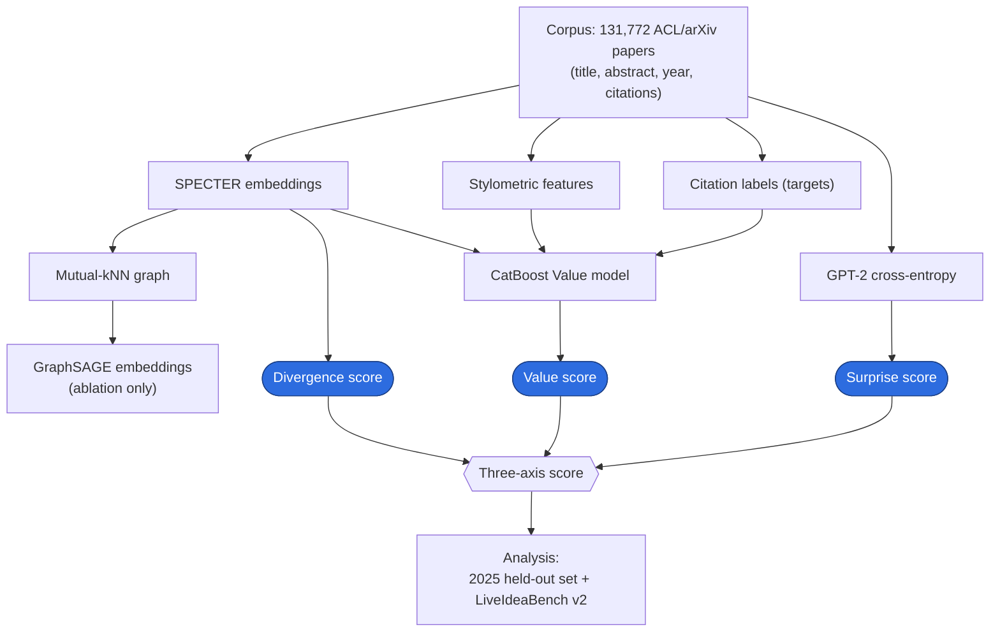

# Disentangling Value, Novelty, and Domain-Conditional Surprise in Research Ideas

An embedding-based framework that scores a research idea on **three independent axes**
instead of a single scalar, and uses it to study the novelty–impact tradeoff in both
published papers and LLM-generated ideas.

| Axis | What it measures | How it is computed |
|---|---|---|
| **Value** | Expected citation impact | CatBoost classifier trained on 131,772 ACL/arXiv papers with year-normalized citation labels |
| **Divergence** | Novelty relative to existing work | Average distance to *k*-nearest neighbors in SPECTER embedding space (mutual-*k*NN graph) |
| **Surprise** | Unexpectedness vs. the NLP literature's prior | Token-level cross-entropy under a GPT-2 medium model fine-tuned on the pre-cutoff corpus |

Headline findings (all reproduced from the notebooks — see **Results** below): a
strong negative correlation between Value and Divergence, a moderate link between
Surprise and LLM-judged originality, and a GraphSAGE ablation showing
graph-structural embeddings add no citation-impact signal beyond SPECTER.

## Pipeline



Only the corpus is a required input; every other box is produced by the notebooks.

## Repository layout

```
.
├── data/                      # inputs (not committed) — see data/README.md
├── train_val_test_split.ipynb # temporal split of the corpus
├── kg/                        # similarity graph + graph embeddings
│   ├── mutual_knn_specter.ipynb   # mutual-kNN graph over SPECTER embeddings
│   ├── mutual_knn_scibert.ipynb   # same graph over SciBERT (ablation)
│   ├── GraphSage.ipynb            # GraphSAGE embeddings from the kNN graph
│   └── graph_diagnostics.ipynb    # structural diagnostics for the divergence metric
├── surprise/                  # the Surprise axis
│   └── finetune_gpt2_scidomain.ipynb  # fine-tune GPT-2 medium → checkpoint + entropy scores
├── val_pred/                  # the Value model
│   ├── models.ipynb               # CatBoost value models across embedding types
│   ├── fine_tuning.ipynb          # tuned final value model
│   └── results/                   # trained models + metrics (committed)
├── insights/                  # the three-axis analysis
│   ├── insights_utils.py          # shared helpers + central `paths` dict
│   ├── comparison.ipynb           # SPECTER vs GraphSAGE (+entropy) ablation
│   ├── inference.ipynb            # three-axis scores on the 2025 held-out set
│   ├── LiveIdea.ipynb             # evaluation on LiveIdeaBench v2 ideas
│   └── results/                   # trained models + metrics (committed)
└── experiments/               # abandoned explorations (local only, gitignored)
```

## Setup

```bash
pip install -r requirements.txt
```

Place the corpus in `data/` as described in [`data/README.md`](data/README.md).
**All paths are relative to the repository root — launch Jupyter from the repo root**
so the notebooks resolve `data/...`, `kg/...`, etc. correctly.

## Reproducing the pipeline

Only the corpus CSV is required as a raw input; every embedding, score, and split is
regenerated by the notebooks. Suggested run order:

1. `train_val_test_split.ipynb` — temporal train/val/test split → `train_val_test_split.json`
2. Generate embeddings (`insights_utils.generate_specter_embeddings`, etc.) → `data/*_embeddings.csv`
3. `surprise/finetune_gpt2_scidomain.ipynb` — fine-tune GPT-2 medium on the pre-cutoff corpus → `data/gpt2_medium_scidomain/` checkpoint and the Surprise scores `data/entropy_scores_2.csv` *(GPU recommended)*
4. `kg/mutual_knn_specter.ipynb` → `kg/mutual_edges@20.npy`
5. `kg/GraphSage.ipynb` → `kg/project_graphsage_embeddings.csv`
6. `val_pred/models.ipynb` → CatBoost value models across embedding types
7. `val_pred/fine_tuning.ipynb` → `val_pred/results/specter_final_final_model.pkl` (the deployed Value model)
8. `insights/comparison.ipynb` → SPECTER vs GraphSAGE ablation
9. `insights/inference.ipynb` → three-axis scores on the 2025 held-out set → `data/combined_scores.csv`
10. `insights/LiveIdea.ipynb` → LiveIdeaBench v2 evaluation

`kg/graph_diagnostics.ipynb` and `kg/mutual_knn_scibert.ipynb` support the divergence
metric and the SciBERT ablation respectively, and can be run independently.

## Results

All numbers below come straight from the committed metrics files and notebook outputs
(cited per row), not from any external write-up. The corpus is 131,772 papers; the
temporally held-out test set is the ~6,958 papers from 2025.

### Value model — citation-impact prediction (2025 test set)

**Target (`is_highly_cited`):** `1` if a paper's citation count is at or above the
**80th percentile within its publication year** (top 20% that year), else `0`.
Percentile-within-year normalization controls for older papers accruing more citations.
Class balance ≈ 20.7% positive. The task is therefore imbalanced, so the headline metric
is PR-AUC.

| Features | Test PR-AUC | Test F1 | Source |
|---|---|---|---|
| SciBERT + stylometric | **0.420** | 0.468 | `val_pred/results/scibert_metrics.json` |
| BERT + stylometric | 0.409 | 0.467 | `val_pred/results/bert_metrics.json` |
| SPECTER + stylometric | 0.404 | 0.457 | `val_pred/results/specter_metrics.json` |

The three text encoders perform within ~0.015 PR-AUC of each other. SPECTER is used for
the downstream axes because it also powers the Divergence metric. The model is CatBoost
with inverse-frequency class weights (see `val_pred/models.ipynb`).

### Ablation — does graph structure or surprise add predictive signal?

| Features | Test PR-AUC | Source |
|---|---|---|
| SPECTER + stylometric | 0.404 | `val_pred/results/specter_metrics.json` |
| SPECTER + stylometric + entropy | 0.400 | `insights/results/specter+entropy_metrics.json` |
| GraphSAGE + stylometric | 0.391 | `insights/results/graphSAGE_metrics.json` |
| GraphSAGE + stylometric + entropy | 0.383 | `insights/results/graphSAGE+entropy_metrics.json` |

Replacing SPECTER with GraphSAGE-refined embeddings **does not** improve citation-impact
prediction (0.391 vs 0.404), and adding the entropy feature does not help either — i.e.
semantic-neighborhood structure carries no extra signal beyond the text embeddings.

### Three axes are largely independent (Spearman ρ)

| Pair | Internal 2025 test | LiveIdeaBench v2 |
|---|---|---|
| Value vs Divergence | **−0.430** | **−0.509** |
| Surprise vs Divergence | +0.243 | +0.140 |
| Value vs Surprise | −0.013 (n.s.) | −0.115 |

*(internal: `insights/inference.ipynb` cell "Correlations … val and test"; LiveIdeaBench:
`insights/LiveIdea.ipynb` correlation cells.)*

Value and Divergence trade off strongly and consistently across both datasets. Of the
top-10% papers by Value and the top-10% by Divergence on the 2025 test set, only **5 of
696 overlap (0.07%)** (`insights/inference.ipynb`).

### Alignment with LLM-judge ratings (LiveIdeaBench v2)

| Model axis vs LLM-judge rating | Spearman ρ | Source |
|---|---|---|
| Surprise vs Originality | **+0.284** | `insights/LiveIdea.ipynb` |
| Divergence vs Originality | +0.278 | `insights/LiveIdea.ipynb` |
| Value vs Feasibility | +0.173 | `insights/LiveIdea.ipynb` |

Surprise and Divergence both track the LLM judges' originality rating, while Value aligns
instead with feasibility — consistent with each axis measuring a distinct property. These
are LiveIdeaBench v2's own LLM-judge scores (an ensemble of frontier models), so read them
as alignment with machine-evaluated dimensions, not human judgment.

## Surprise model

The Surprise axis uses a GPT-2 medium model fine-tuned on the pre-cutoff corpus.
`surprise/finetune_gpt2_scidomain.ipynb` reproduces it end to end: it fine-tunes the model
(saving `data/gpt2_medium_scidomain/`) and writes the per-paper Surprise scores to
`data/entropy_scores_2.csv`. A GPU is recommended for this step.
